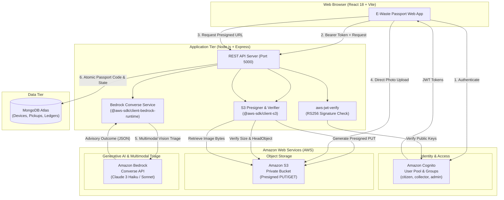
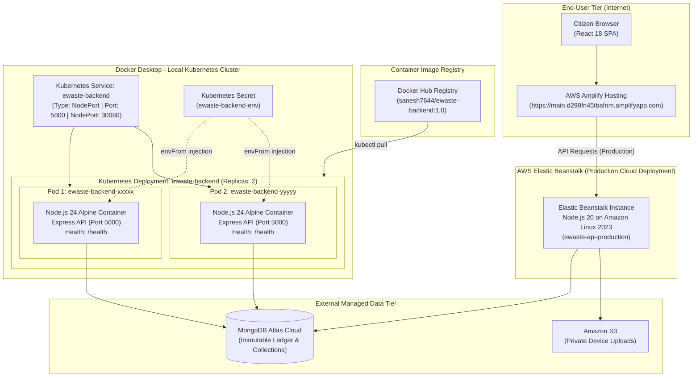

# E-Waste Passport

> **Track 03: Waste and Energy**  
> *"A passport for every old device, from the owner's hand to its final outcome."*

### 🚀 Live Demo

<p align="center">
  <a href="https://main.d298fn45tbafnm.amplifyapp.com/" target="_blank">
    
  </a>
</p>

[](https://github.com/Sanesh764/Energy_recycle)
[](https://vitejs.dev/)
[](https://nodejs.org/)
[](https://mongodb.com/)
[](https://hub.docker.com/r/sanesh7644/ewaste-backend)
[](https://kubernetes.io/)
[](./LICENSE)

---

## 1. Project Overview

**E-Waste Passport** is a civic circular-economy platform designed to solve electronic waste hoarding and unmanaged disposal by providing end-to-end lifecycle traceability for retired electronics. 

Every device registered by a citizen receives an immutable digital passport tracking its journey through:
1. **Multimodal AI triage** (condition analysis & disposition guidance)
2. **Doorstep collection** by authorized local handlers
3. **Physical diagnostic inspection**
4. **Verified final outcome** (**REPAIR**, **REUSE**, **RESALE**, or **RECYCLE**)

Citizens earn **EcoCoins** upon verified collection, which can be redeemed for sample shopping vouchers and mobility discounts in the demo store. Administrators oversee system-wide operations and audit real-world environmental impact using published international characterization factors (**ITU / UNITAR Global E-waste Monitor 2024**).

---

## 2. Technology Stack

The platform is designed following modern cloud-native, microservices, and containerization principles:

| Layer | Technologies & Tools | Key Role & Capabilities |
| :--- | :--- | :--- |
| **Frontend** | React 18, Vite 6, Tailwind CSS, React Router v6 | Responsive single-page application with role-based UI flows for Citizens, Collectors, and Admins. |
| **Backend** | Node.js (LTS), Express 4.21, Mongoose 8.9, Zod 3.24, Bcryptjs | High-throughput REST API with strict request validation schemas, concurrency locks, and lifecycle state transitions. |
| **Database** | MongoDB 7.0+ (Atlas Cloud / Local) | Flexible document store for devices, immutable audit timelines, pickups, and reward ledgers. |
| **Containerization** | Docker, Docker Compose | Minimal Alpine-based production image (`node:24-alpine`), dependency caching, and environment parity between local and cloud execution. |
| **Orchestration** | Kubernetes (Docker Desktop) | High-availability cluster management with 2 replica pods, declarative deployments, NodePort routing, and health probes. |
| **Image Registry** | Docker Hub (`sanesh7644/ewaste-backend:1.0`) | Public verified container repository for automated image delivery. |
| **Cloud & Deployment** | AWS Amplify (Frontend), AWS Elastic Beanstalk (Backend API) | Serverless frontend hosting with global CDN, alongside autoscaling platform infrastructure for backend workloads. |
| **Cloud Services** | Amazon S3, Amazon Bedrock (Claude 3), Amazon Cognito | Zero-exposure private photo storage, multimodal AI computer-vision triage, and RS256 JWT cryptographic authentication. |
| **Testing & Quality** | Jest 29, Supertest 7 | **180 automated tests across 12 test suites** validating security boundaries, status machines, and concurrency safety. |

---

## 3. AWS Cloud Architecture & Integration

E-Waste Passport is architected as an **AWS Cloud-Native Sustainability Solution**. It leverages AWS services to guarantee enterprise-grade security, private blob storage, and multimodal computer vision without keeping raw image binaries in the database.


### 3.1 Cloud Architecture Diagram



### 3.2 Text Architecture Flow

```
+-----------------------------------------------------------------------------------------+
|                                    CLIENT APPLICATION                                   |
|                          (Citizen, Collector, Admin Portals)                            |
+---------------------+-------------------------------+-----------------------------------+
                      │                               │
         1. Authentication (JWT)         3. Direct Photo Upload (Presigned PUT)
                      ▼                               ▼
       +-------------------------------+   +------------------------------------+
       |         AMAZON COGNITO        |   |              AMAZON S3             |
       |  - User Pool & Groups         |   |  - Private Devices Bucket          |
       |  - Cryptographic Public Keys  |   |  - Presigned Short-Lived PUT & GET |
       +---------------+---------------+   +-----------------+------------------+
                       │                                     │
                       ▼                                     ▼
+-----------------------------------------------------------------------------------------+
|                               EXPRESS BACKEND API GATEWAY                               |
|                                                                                         |
|  [Auth Middleware: aws-jwt-verify]   [Storage Service: @aws-sdk/client-s3]              |
|  • Verifies RS256 token signatures   • HeadObject checks MIME & size (<3MB)             |
|  • Enforces RBAC permissions         • Extracts image bytes for AI vision               |
|                                                                                         |
|                   [AI Service: @aws-sdk/client-bedrock-runtime]                         |
|                   • Calls Amazon Bedrock Converse API (Claude 3)                        |
|                   • Analyzes photo evidence + hardware condition                        |
|                   • Enforces JSON schema: REPAIR, REUSE, RESALE, RECYCLE                |
+---------------------------------------------+-------------------------------------------+
                                              │
                              6. Store Passport & Timelines
                                              ▼
                             +---------------------------------+
                             |         MONGODB DATABASE        |
                             |  - Digital Device Passports     |
                             |  - Immutable Audit Timelines    |
                             |  - Concurrency-Locked Pickups   |
                             |  - Citizen Rewards Ledger       |
                             +---------------------------------+
```

### 3.3 Deep Dive on AWS Services Used

| AWS Service | SDK Package | Role in E-Waste Passport | Architectural Rationale |
| :--- | :--- | :--- | :--- |
| **Amazon Bedrock** | `@aws-sdk/client-bedrock-runtime` | **Multimodal Computer Vision & AI Triage** | Ingests device photographs and reported condition parameters using the `ConverseCommand` API (Anthropic Claude 3). Automatically categorizes the hardware and generates an initial disposition recommendation (**REPAIR**, **REUSE**, **RESALE**, **RECYCLE**) along with data-sanitization instructions. |
| **Amazon S3** | `@aws-sdk/client-s3`<br>`@aws-sdk/s3-request-presigner` | **Secure Zero-Exposure Private Image Storage** | Keeps database documents lightweight by storing device photos in a private S3 bucket. Employs **Presigned PUT URLs** allowing client browsers to upload directly to S3 within the `devices/${uuid}.${ext}` namespace. Validates file integrity, MIME types (`image/jpeg`, `image/png`), and payload size limits (<3MB) before database persistence. |
| **Amazon Cognito** | `aws-jwt-verify` | **Enterprise Identity & Role-Based Access Control** | Authenticates users against an AWS Cognito User Pool. Verifies cryptographic RS256 JWT signatures against AWS JWKS endpoints. Maps Cognito user pool groups directly into the platform's three authorization boundaries: `citizen`, `collector`, and `admin`. |

### 3.4 Hybrid Cloud Strategy (Production vs. Local Evaluation)

To ensure this project is **100% resilient during hackathon judging and live demonstrations**, the codebase incorporates cloud abstraction layers:

- **When AWS Credentials are Present:** The system automatically executes live Bedrock multimodal vision, live S3 presigned transfers, and live Cognito token authentication.
- **When Evaluating Locally / Offline:** The backend uses built-in development adapters—including a local private upload mock, a deterministic advisory AI fallback, and server-side bcrypt authentication—ensuring the application never crashes or blocks device registration even if AWS cloud quotas or network connections are unavailable.

---

## 4. Containerization & Kubernetes Orchestration

E-Waste Passport implements **enterprise containerization and microservices orchestration** to ensure deterministic execution, high availability, and rapid autoscaling across any environment.

### 4.1 Engineering Rationale & Benefits

- **Why Docker:** Eliminates the *"it works on my machine"* dilemma by packaging the Node.js runtime, pinned Alpine system libraries, production dependencies, and application code into an immutable, portable artifact.
- **Role of `Dockerfile`:** Specifies a multi-stage production environment based on `node:24-alpine`. Runs `npm ci --omit=dev` to produce a hardened, lightweight container image (excluding test frameworks, compilers, and development tools) and explicitly exposes port `5000`.
- **Role of `.dockerignore`:** Prevents local build artifacts, temporary log files, `.git`, `coverage`, and critical environment secrets (`.env*`) from leaking into the container build context or public image registry.
- **Role of `docker-compose.yml`:** Automates local single-command environment startup, container port binding (`5000:5000`), container lifecycle management (`restart: unless-stopped`), and environment parameter ingestion.
- **Role of Kubernetes:** Orchestrates the containerized backend for enterprise resilience. Handles self-healing (automatic restart on pod failure), horizontal scaling (multi-replica management), declarative zero-downtime rollouts, and internal service load-balancing.
- **Probes & Secrets:**
  - **Readiness Probe (`/health`):** Verifies that both the Express HTTP server and MongoDB connection are active before routing incoming traffic to the pod.
  - **Liveness Probe (`/health`):** Continuously monitors container responsiveness and automatically replaces stalled or unrecoverable containers.
  - **Kubernetes Secret (`ewaste-backend-env`):** Decouples application configuration from container images, safely injecting environment variables into pods at runtime without storing secrets in plain text or version control.

---

### 4.2 Architecture Diagram: Docker & Kubernetes

The following architecture diagram illustrates the end-to-end containerized topology, distinguishing the **AWS Cloud Deployment** from the local **Docker Desktop Kubernetes Cluster**:



> [!NOTE]
> **Deployment Topology Distinction:** The frontend is hosted on **AWS Amplify**, and the primary production cloud API runs on **AWS Elastic Beanstalk**. The **Kubernetes Cluster (2 Replicas)** documented below runs locally on **Docker Desktop Kubernetes**, demonstrating microservices orchestration readiness, self-healing, and multi-replica scalability.

---

### 4.3 Docker Setup (Single-Command Local Execution)

To spin up the containerized backend locally using Docker Compose, run the following copy-pasteable PowerShell commands:

```powershell
# 1. Navigate to the backend directory
cd "C:\Users\ASUS\Desktop\e-waste passport\backend"

# 2. Build the production image and start the container in detached mode
docker compose up -d --build

# 3. Check container status
docker compose ps

# 4. Stream real-time container logs
docker compose logs -f backend
```

#### Verifying Docker Container Health:

```powershell
# Send an HTTP GET request to the containerized health endpoint
Invoke-RestMethod http://localhost:5000/health
```

Expected response:
```json
{
  "status": "ok",
  "uptime": 12,
  "database": "connected"
}
```

To stop the container:
```powershell
docker compose down
```

---

### 4.4 Docker Hub Image Registry

The backend image is publicly published to Docker Hub:
**Image Repository:** [`sanesh7644/ewaste-backend:1.0`](https://hub.docker.com/r/sanesh7644/ewaste-backend)

To build, tag, and publish the image to Docker Hub, run:

```powershell
# 1. Build the production container image
docker compose build

# 2. Tag the locally built image with the versioned repository tag
docker tag ewaste-backend:local sanesh7644/ewaste-backend:1.0

# 3. Push the image to Docker Hub
docker push sanesh7644/ewaste-backend:1.0
```

> [!IMPORTANT]
> **Zero Credential Exposure:** Secrets, credentials, database URIs, and AWS tokens are excluded via `.dockerignore` and are never baked into container layers or pushed to Docker Hub.

---

### 4.5 Kubernetes Orchestration (Docker Desktop)

The production Kubernetes configuration resides in `backend/k8s/`:
- [`backend/k8s/deployment.yaml`](file:///c:/Users/ASUS/Desktop/e-waste%20passport/backend/k8s/deployment.yaml) — Defines the 2-replica `Deployment`, container image, container port `5000`, environment secret reference, and readiness/liveness health probes.
- [`backend/k8s/service.yaml`](file:///c:/Users/ASUS/Desktop/e-waste%20passport/backend/k8s/service.yaml) — Defines the `NodePort` Service directing traffic to port `5000` (NodePort: `30080`).

#### Step 1: Create the Runtime Secret

Kubernetes reads environment variables from a Secret named `ewaste-backend-env`. Generate this secret on your local cluster using your environment values:

```powershell
kubectl create secret generic ewaste-backend-env `
  --from-literal=NODE_ENV=production `
  --from-literal=PORT=5000 `
  --from-literal=MONGODB_URI="mongodb+srv://<db_user>:<db_password>@<cluster>.mongodb.net/e-waste-passport?retryWrites=true&w=majority" `
  --from-literal=ALLOW_DEV_DEMO_AUTH=false `
  --from-literal=CORS_ORIGIN="https://main.d298fn45tbafnm.amplifyapp.com" `
  --from-literal=AWS_REGION=us-east-1 `
  --from-literal=S3_BUCKET_NAME="e-waste-passport-uploads-demo" `
  --from-literal=BEDROCK_MODEL_ID="anthropic.claude-3-haiku-20240307-v1:0"
```

> [!WARNING]
> Never commit actual Kubernetes Secret YAML files containing sensitive passwords or connection strings to version control. In enterprise production, use AWS Secrets Manager, HashiCorp Vault, or SealedSecrets with strict RBAC access controls.

#### Step 2: Apply Deployment & Service Manifests

```powershell
# Apply manifests
kubectl apply -f k8s/deployment.yaml
kubectl apply -f k8s/service.yaml
```

#### Step 3: Inspect & Manage Cluster Resources

```powershell
# Verify cluster nodes
kubectl get nodes

# Verify deployment status (Replicas: 2/2)
kubectl get deployments

# Inspect active pods
kubectl get pods

# Inspect the Service and assigned NodePort
kubectl get services

# Inspect container logs across the deployment
kubectl logs deployment/ewaste-backend

# Local port forwarding for diagnostic inspection
kubectl port-forward service/ewaste-backend 8080:5000
```

> [!NOTE]
> `kubectl port-forward` creates a direct tunnel between your local workstation and the Kubernetes Service for private debugging. It does **not** expose the service publicly to the internet.

---

### 4.6 Verification & Testing Results

All deployment configurations, container images, and cluster objects have been rigorously validated:

| Verification Target | Expected Standard | Validated Result | Status |
| :--- | :--- | :--- | :--- |
| **Backend Test Suite** | 100% Passing Tests | **180 passed, 180 total** across **12 Jest test suites** | ✅ Verified |
| **Security Boundaries** | Role isolation & fail-closed prod auth | Verified via `security.test.js` & `devAuth.test.js` | ✅ Verified |
| **Kubernetes Replica Count** | Desired: 2 / Ready: 2 | **2/2 available pods** reaching `Running` state | ✅ Verified |
| **Readiness & Liveness Probes** | Path: `/health`, Port: 5000 | Both probes succeeded without restarts | ✅ Verified |
| **Database Connectivity** | Live MongoDB connection | `/health` returns `status: ok` and `database: connected` | ✅ Verified |
| **Docker Hub Image Pull** | Pull `sanesh7644/ewaste-backend:1.0` | Container boots cleanly on `node:24-alpine` | ✅ Verified |

---

## 5. Verified Demo Accounts & Credentials

The database comes pre-seeded with verified test accounts across all three roles. Passwords are encrypted using bcrypt (10 rounds):

| Role | Email Address | Password | Permissions & Available Views |
| :--- | :--- | :--- | :--- |
| **Admin** | `sanesh7644@gmail.com` | `password@123` | System oversight, read-only audit register, aggregate empirical impact metrics (`/admin/stats`, `/admin/devices`) |
| **Collector 1** | `santosh@gmail.com` | `password@123` | Open pickups in PIN codes `110001`, `110002`, doorstep collection, physical inspection (`/collector/open`, `/collector/my-pickups`) |
| **Collector 2** | `collector2@ewaste.local` | `password@123` | Secondary authorized collector for concurrent pickup acceptance testing |
| **Collector 3** | `collector3@ewaste.local` | `password@123` | Tertiary authorized collector |
| **Citizen** | `citizen@example.org` | `password@123` | Device registration, doorstep pickup booking, EcoCoins wallet (`/citizen/devices`, `/citizen/rewards`) |
| **New Citizen** | *Public Registration* | *User-defined* | Public signup automatically creates citizen accounts (`POST /api/auth/signup`) |

---

## 6. Quick Start (Local Development)

### Step 1: Clone & Install Dependencies

```bash
# Clone the repository
git clone https://github.com/Sanesh764/Energy_recycle.git
cd Energy_recycle

# Install backend dependencies
cd backend
npm install

# Install frontend dependencies
cd ../frontend
npm install
cd ..
```

### Step 2: Seed Database with Reference Factors & Demo Accounts

Run the idempotent database seed script:

```bash
cd backend
npm run seed
```

This populates:
1. **Authoritative Impact Factors:** Published characterization data from the **ITU Global E-waste Monitor 2024** for `PHONE` (0.2 kg, 80% recyclable), `LAPTOP` (2.5 kg, 85% recyclable), and `TV` (15.0 kg, 75% recyclable).
2. **Verified Test Accounts:** Admin (`sanesh7644@gmail.com`), Collectors (`santosh@gmail.com`), and Citizen (`citizen@example.org`) with hashed passwords.
3. **Sample Devices:** Pre-configured sample devices (`isSample: true`) illustrating all lifecycle stages (`EW-2026-000101` to `EW-2026-000105`).
4. **Initial Rewards Ledger:** Seeded transactions and 120 EcoCoins for the citizen account.

### Step 3: Start Backend Server

```bash
cd backend
npm start
```
*API runs on `http://localhost:5000` (Health check: `http://localhost:5000/api/health`).*

### Step 4: Start Frontend Application

In a separate terminal:

```bash
cd frontend
npm run dev
```
*Frontend runs on `http://localhost:5173`.*

---

## 7. Public Homepage & Navigation

The public homepage (`/`) has been completely redesigned with a high-trust circular-economy aesthetic:

- **Hero Section:** Headline *"Turn Your E-Waste Into Rewards."* with prominent CTAs (`Recycle Now` and `Track My Device`) and an interactive passport preview card.
- **Dedicated EcoCoins Showcase (`#rewards`):** Visual wallet card showing demo balance, transaction history, and sample discount coupons.
- **Why Choose E-Waste Passport (`#why-us`):** Four core features (doorstep pickup, transparent tracking, eco rewards, AI assistance).
- **How It Works (`#how-it-works`):** Visual 4-step workflow (Register → Request → Verify → Track & Earn).
- **Stakeholder Roles (`#roles`):** Segregated portals for Citizens, Collectors, and Administrators.
- **Transparent Impact (`#impact`):** Empirical recovery formulas citing published ITU / UNU-KEY factors.
- **About the Developer (`#developer`):** Profile details for Sanesh Kumar with verified links.
- **Cross-Route Section Anchoring:** Clicking any section link from `/login` or `/signup` automatically navigates to the homepage and smoothly scrolls directly into view.

---

## 8. Authentication Architecture & Security Boundaries

### Production Mode (Amazon Cognito User Pool)
- Validates cryptographic JWT signatures via `CognitoJwtVerifier` against AWS JWKS keys.
- Role groups (`citizen`, `collector`, `admin`) are extracted from token claims.
- Users with no groups default strictly to `citizen`. Unknown groups are rejected with HTTP 403.

### Local Development Mode (`ALLOW_DEV_DEMO_AUTH=true`)
- Session tokens are issued by `POST /api/auth/login` upon verifying bcrypt-hashed passwords.
- Validates active sessions via `GET /api/auth/me`.
- Public signup (`POST /api/auth/signup`) is strictly locked to `role: 'citizen'`. Any client attempts to supply `role: 'admin'` or `role: 'collector'` are ignored by the server.
- Duplicate email registration is prevented with HTTP 409 Conflict.

### Fail-Closed Production Guardrail
- When `NODE_ENV === 'production'`, any development tokens (`dev-token-*` or `ewaste-demo-*`) are immediately rejected with HTTP 401 Unauthorized.

---

## 9. Running Tests & Production Build

### Backend Test Suite (180 Tests across 12 Suites)

```bash
cd backend
npm test
```

All 12 test suites execute in band:
- `tests/security.test.js` — 16 security & boundary tests (unauthenticated rejection, public signup role enforcement, role boundary isolation, admin access, session validation, production fail-closed security)
- `tests/auth.test.js` — Cognito JWT verification, group mapping, and role extraction
- `tests/devAuth.test.js` — Dev demo auth guardrails and production rejection
- `tests/rewards.test.js` — EcoCoins wallet balance, coupon redemptions, anti-duplicate collection awarding
- `tests/devices.test.js` — Device registration, atomic code generation, inspection, and completion
- `tests/pickups.test.js` — Pickup lifecycle & concurrency protection
- `tests/admin.test.js` — Admin impact calculation & sample data exclusion toggle
- `tests/seed.test.js` — Published reference factor integrity
- `tests/uploads.test.js` — S3 presigned URL validation
- `tests/statusMachine.test.js` — Centralized lifecycle state machine
- `tests/ai.test.js` — Bedrock Converse AI integration & deterministic fallback
- `tests/health.test.js` — Health check endpoint

### Frontend Production Build

```bash
cd frontend
npm run build
```

Compiles the application to production bundle in `dist/` with 0 errors.

---

## 10. Three-Minute Demo Video Recording Script

Follow this sequence to record a crisp, 3-minute video presentation:

### Scene 1: Landing Page & Problem Pitch (0:00 – 0:35)
- **URL:** `http://localhost:5173/`
- **Actions:**
  - Scroll past the hero banner showing the headline *"Turn Your E-Waste Into Rewards."*
  - Highlight the dedicated **EcoCoins** rewards card and sample coupons.
  - Show the 4-step workflow: *Register → Request → Verify → Track & Earn*.
  - Click **"Recycle Now"** to open Citizen registration or sign in.
- **Narration:**
  > *"Every year, over 62 million tonnes of electronic waste are discarded worldwide. Citizens keep old laptops and smartphones in drawers because they don't know where they end up. E-Waste Passport solves this by creating an immutable digital passport for every device, connecting owners to certified collectors and rewarding responsible disposal with EcoCoins."*

### Scene 2: Citizen Device Registration & AI Triage (0:35 – 1:15)
- **URL:** `http://localhost:5173/citizen/devices/new`
- **Actions:**
  - Select Category: **Laptop**, Age: **3 years**, Powers on: **Yes**, Condition: **Working - Minor Scratches**.
  - Enter required pickup address: House *"Flat 402, Green Enclave"*, Locality *"Sector 14"*, City *"New Delhi"*, PIN Code *"110001"*, Phone *"9876543210"*.
  - Submit device: AI suggests **REPAIR** with safety tips.
  - Review the generated passport code (e.g. `EW-2026-000106`) and confirm the pickup request.
- **Narration:**
  > *"As a citizen, I register an old laptop. The platform captures hardware specifications and photo evidence, calling Amazon Bedrock for multimodal triage. The AI suggests 'Repair' with safety tips. I confirm my pickup address, and a unique passport is issued with real-time tracking."*

### Scene 3: Collector Acceptance & Custody Verification (1:15 – 1:55)
- **URL:** `http://localhost:5173/login` (or Quick Switch to Collector)
- **Actions:**
  - Sign in as Collector (`santosh@gmail.com` / `password@123`).
  - Open **"Open Pickups"** (`/collector/open`). Notice the laptop pickup matching service PIN code `110001`.
  - Click **"Accept Pickup"** (concurrency-safe atomic claim).
  - Navigate to **"My Pickups"** (`/collector/my-pickups`) and click **"Mark Collected"**.
  - Click **"Perform Inspection"**, select Final Confirmed Outcome: **REPAIR**, and submit completion.
- **Narration:**
  > *"Switching to the field collector view, I see open pickups in my authorized postal codes. I accept the request with concurrency protection. Upon doorstep handover, I mark the device Collected, which immediately credits EcoCoins to the citizen. After diagnostic inspection, I record the authoritative outcome—Repair—completing the passport lifecycle."*

### Scene 4: Citizen Reward Wallet & Interactive Redemption (1:55 – 2:25)
- **URL:** `http://localhost:5173/citizen/rewards`
- **Actions:**
  - Return to Citizen view (`citizen@example.org`).
  - Point out the updated EcoCoins balance (+50 coins credited from the verified collection) and the new entry in the Transaction Ledger.
  - Click **"Redeem"** on the *₹100 Green Electronics Voucher*.
  - Show the interactive success modal and generated promo code (`ECO-40-XXXXXX`).
- **Narration:**
  > *"Back in the citizen portal, my Rewards Wallet immediately reflects +50 EcoCoins from the verified collection. I can redeem these coins interactively for shopping vouchers or EV mobility passes, turning unwanted e-waste into tangible community incentives."*

### Scene 5: Admin Impact Analytics & AI Guide (2:25 – 3:00)
- **URL:** `http://localhost:5173/admin/stats`
- **Actions:**
  - Sign in as Admin (`sanesh7644@gmail.com` / `password@123`).
  - Highlight the empirical impact metrics: *Completed Devices Handled*, *Kept in Use (kg)*, and *Recyclable Material (kg)*.
  - Toggle the **"Exclude Sample Data"** checkbox to show transparent separation of pilot samples from live data.
  - Click the floating **"E-Waste AI Guide"** widget in the bottom right corner to demonstrate grounded device-wiping advice.
- **Narration:**
  > *"Finally, the sustainability admin dashboard aggregates real-world circular impact using verified ITU Global E-waste Monitor factors. Administrators can audit outcomes and toggle sample pilot data with a single click. The built-in AI Guide ensures citizens always have grounded guidance on data sanitization and recycling. E-Waste Passport delivers complete traceability—from the owner's hand to certified outcome."*

---

## 11. Developer & Project Information

- **Developer:** Sanesh Kumar
- **GitHub:** [https://github.com/Sanesh764](https://github.com/Sanesh764)
- **LinkedIn:** [https://www.linkedin.com/in/sanesh-kumar/](https://www.linkedin.com/in/sanesh-kumar/)
- **Repository:** [https://github.com/Sanesh764/Energy_recycle](https://github.com/Sanesh764/Energy_recycle)
- **Track:** Waste and Energy (Track 03)

---

## 12. License

This project is licensed under the ISC License.

